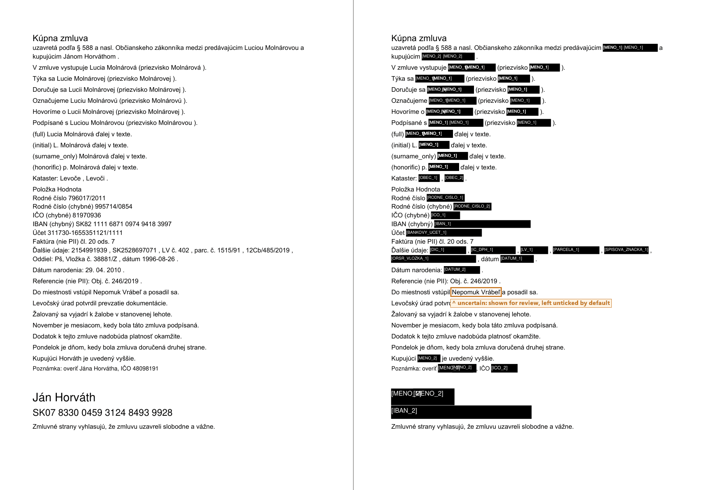

# Slovak Legal Document Anonymizer

A desktop app that removes names, birth numbers, addresses, bank accounts and other personal
data from Slovak legal documents (`.docx` and `.pdf`), entirely on your own computer: no cloud,
no network calls.

<a href="docs/demo_before_after.png"></a>

**On this document: 0 of 33 must-redact items left with the parties' names typed in, 6 left
without them.** One uncertain name was flagged for the reviewer to decide (orange box, drawn for
the demo only).

<sub>A synthetic test contract: the first file this repo's generator writes, not hand-picked, and
a checklist of test cases rather than a real-looking contract. *Must-redact* = items the generator
marks as always to be removed. Doubled labels are a known cosmetic PDF issue. Click for full size.</sub>

- **What it does:** finds personal data in a Word or PDF document and writes a redacted copy in
  which each person gets one consistent label (`Ján Novák`, `Jána Nováka` → `[MENO_1]`), plus a
  report of every change and of everything it was unsure about.
- **Headline result:** on 140 generated test files (70 synthetic legal documents, each as `.docx`
  and `.pdf`), with the parties' names supplied as the app asks, **no must-redact item survives**,
  checked in the text, metadata, comments and hidden parts. These files come from the repo's own
  generator, so this is not recall on real documents. Letter-spaced text is still mostly missed ([all checks](#tests-and-quality-checks)).
- **How:** rules, not machine learning: patterns with checksum validation for identifiers, public
  Slovak lists of towns, streets and names that understand Slovak word endings, and the names you
  type in. Uncertain cases go to you for review.

[Plain-language overview](legal_anonymizer_plain.md) · [Internal red-team rounds](redteam/) ·
[Licence and data sources](#licence-and-data-sources)

## How it works

1. **You add files** and, optionally but strongly recommended, type the parties' names and
   addresses. Those are the most reliable input the tool gets.
2. **It scans** the text with three detectors: identifier patterns with checksums (*rodné číslo*
   = birth number, *IČO* / *DIČ* / *IČ DPH* = company, tax and VAT numbers, IBAN …), public lists
   of towns, streets, cadastral areas, first names and surnames, and your names in all their
   Slovak grammatical forms (`Ján Novák`, `Jána Nováka`, `p. Novák`).
3. **You review** a table of what was found. Confident hits are ticked; uncertain ones are
   unticked and wait for your decision.
4. **It writes** `<name>_anon.docx` / `.pdf` next to the original (which is never changed) and a
   report listing every redaction and every item it left for review.

The rule for every unclear case is **redact rather than leave**: an extra redaction costs a
reviewer two seconds, a missed one is a data breach. The tool never claims a document is
"clean"; the report is there so a person can check it.

## What it does not do

- **Scanned documents or images.** It reads the text layer only. A PDF with no text layer is
  refused with a message, never handed back looking anonymized.
- **Signatures and stamps** are images, so they stay in place.
- **Trade secrets and classified information** (clause (i) of Slovak decree 482/2011) are defined
  by meaning, not by any pattern, so they are out of scope. A person has to handle them.
- **No machine-learning name recognition**, so an unusual surname that is not in the public lists
  and not typed in can be missed (the demo's empty-names run leaves 6 mentions of such a surname).
- **Letter-spaced text** (`J á n  N o v á k`) is mostly missed (see the checks below).
- **Cosmetic:** in PDFs, two labels can print on top of each other where a name was matched twice
  (for example a first name and a full name). The text under the box is removed either way.

## Quickstart

Needs Python 3.11 and [uv](https://docs.astral.sh/uv/). Developed and tested on Windows 11;
other systems are untested. Direct dependencies are pinned in `requirements.txt` (no lockfile).

```bash
git clone https://github.com/matus012/legal-anonymizer.git
cd legal-anonymizer
uv venv --python 3.11
uv pip install -r requirements.txt
```

Activate the environment (Windows: `.venv\Scripts\activate`, macOS / Linux:
`source .venv/bin/activate`), then make 140 synthetic files in `data/synthetic/` and start the app:

```bash
python -m corpus.generate --n 70 --out data/synthetic --seed 42 --formats docx,pdf
python -m gui
```

In the app: **Pridať súbory…** (add files) → pick e.g. `data/synthetic/kupna_zmluva_000.pdf` →
type the parties' names → **Skenovať** (scan) → review → **Exportovať všetko** (export all). The
app works fully offline; it is meant to run with the network adapter disabled.

## Tests and quality checks

Run in the activated environment, after the corpus command above. Real client documents are never
used for development or testing.

```bash
python -m tools.make_demo       # writes demo files that some tests read (not the README figure)
python -m pytest -q
python -m eval.leak_gate
python -m eval.mutation_gate
python -m eval.cross_format_gate
python -m eval.precision_report
```

| check | what it asks | result |
|---|---|---|
| test suite | does everything still behave as specified? | 1711 passed, 9 skipped, 12 expected failures (open red-team findings, pinned so a fix shows up) |
| leak gate | after redaction, does any must-redact string survive anywhere in the file (text, metadata, comments, hidden parts)? | **pass**: 0 in 140 files (2 bank-code byte matches set aside by rule) |
| mutation gate | is data still found when written with odd spacing, line breaks, no accents, look-alike letters …? | **fails**: of 16 gated spellings, 15 are found ≥ 95 % of the time; letter-spaced text 12 %. Words split across lines: 46 % (measured, not gated) |
| cross-format gate | does the same document give the same hits as `.docx` and `.pdf`? | **pass**: 76 pairs, 0 differences |
| precision report | how much is redacted that did not need to be? (never pass / fail) | most types 100 %, names 98.9 %; towns 24 %, cadastral areas 36 % (it would rather black out too much than miss something) |

<sub>Measured 2026-11-21 with Python 3.11 on code commit `064f3b5` (this README update changes no
app code). The leak gate supplies each document's party names, as a user would; it sets aside two
4-digit bank codes that match inside raw PDF bytes, by a documented rule, and prints them. The
cross-format gate checks the 70 corpus pairs plus 6 control pairs it builds itself. The test
documents come from this repo's own generator, which uses the same public lists as the detectors,
so these checks test the pipeline end to end; they are not a measure of recall on real documents.
Six internal red-team rounds attacked the extractor, the detectors, the Word package and the PDF
container; findings and fixes are in [`redteam/`](redteam/).</sub>

<details>
<summary>Building the Windows .exe (PyInstaller)</summary>

```bash
python -m PyInstaller anonymizer.spec --noconfirm
```

This makes a one-folder build at `dist/Anonymizer/Anonymizer.exe`. After every build, check that
the six list files (`obce.json`, `ulice.json`, `katastralne_uzemia.json`, `first_names.json`,
`surnames.json`, `stoplist.json`) are under `dist\Anonymizer\_internal\detect\gazetteer_data\`
(note the `_internal\`). A build without them would stop finding place names and personal names;
the app checks for them at start-up and refuses to scan, but check the build anyway.

</details>

The README figure is rebuilt with `python -m tools.make_readme_demo` (needs `pillow`).

## Repo layout

```
gui/        the desktop app (PySide6): add files → review → export
detect/     the detectors and the bundled lists (detect/gazetteer_data/*.json)
writer/     writes the redacted .docx / .pdf and the report
corpus/     synthetic document generator with ground truth
eval/       leak, mutation, cross-format, precision and speed checks
redteam/    six rounds of adversarial findings
tests/      pytest suite
tools/      list builder, demo and test-document generators
test_docs/  a quick manual test guide for the office (Slovak)
docs/       the before/after figure
```

Design documents: [`CONTRACTS_v11.md`](CONTRACTS_v11.md) (frozen v1.1 interfaces), [`QUESTIONS.md`](QUESTIONS.md) (design questions and answers),
[`office_note.md`](office_note.md) (note to the office about what v1 does not cover).

## Licence and data sources

Code: **AGPL-3.0-only** ([LICENSE](LICENSE)), because the PDF engine, PyMuPDF, is AGPL-3.0. Every
code dependency with its licence: [THIRD_PARTY.md](THIRD_PARTY.md).

The bundled lists are built from public sources ([LICENSES.md](LICENSES.md); rebuild with
`python -m tools.build_gazetteer`): towns and streets from the Ministry of Interior address
register (CC0 1.0); cadastral areas from ÚGKK SR codelist CL000026 (CC BY 4.0: *"Contains data
from ÚGKK SR, codelist CL000026, licensed under CC BY 4.0."*); first names (MIT / CC0 1.0) and
surnames (CC0 1.0). Name lists derived from leaked personal data were rejected on purpose.
